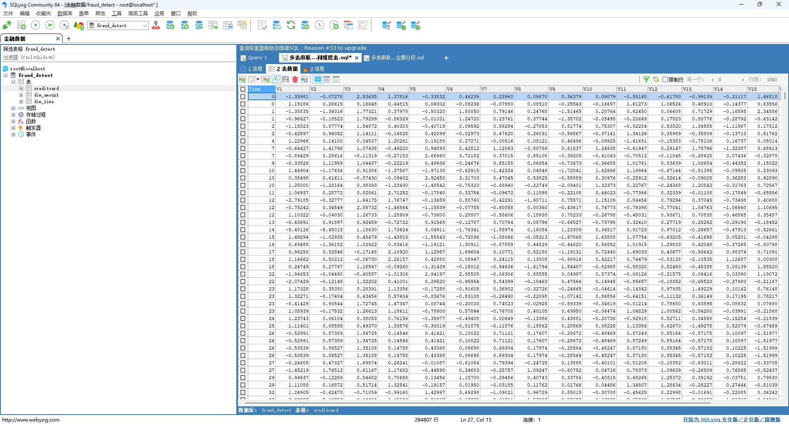
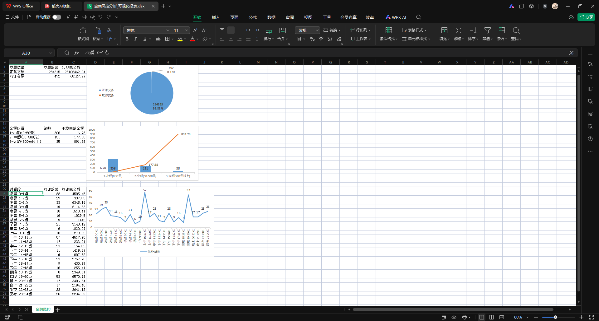

# 基于 28万+ 真实交易数据的金融风控分析

## 📖 项目简介
本项目基于 Kaggle 公开的真实脱敏信用卡交易数据集（约 28.5 万条记录），使用 Python 完成数据清洗与入库，并在 MySQL 中运用多表关联与聚合函数进行深度业务分析。最终使用 Excel 输出可视化图表，挖掘欺诈交易的作案特征与时间规律。

## 🛠️ 技术栈
*   **编程语言**：Python (Pandas, SQLAlchemy)
*   **数据库**：MySQL (星型模型建模, 多表关联, 分组聚合, 窗口函数)
*   **数据可视化**：Excel / WPS

## 🔍 业务分析洞察
1.  **极度不平衡的样本**：正常交易 284,315 笔 vs 欺诈交易 492 笔（仅占 **0.17%**），揭示了金融风控中的核心痛点。
2.  **作案金额特征**：欺诈分子呈现“小额试探（均 6.78 元）、大额盗刷（均 891.28 元）”的显著特征。
3.  **时间规律分布**：通过时间维度串联，定位出欺诈交易在**上午 10-11 点**及**傍晚 19-20 点**呈明显高发趋势，为风控拦截规则提供数据支撑。

## 📁 项目文件说明
* `01_导入数据脚本.py`：使用 Pandas 读取 CSV 并分块写入 MySQL 的核心代码。
* `02_建表与维度建模.sql`：包含事实表、时间维度表、金额维度表的建表语句。
* `03_探查欺诈样本比例.sql`：核心业务分析 SQL（包含 JOIN, GROUP BY, 外连接等）。
* `04_多表串联业务查询.sql`：利用时间维度表进行多表串联的高级查询。
* `05_金融风控分析_可视化报表.xlsx`：包含最终输出的饼图、组合图与趋势折线图。

## 📊 可视化与数据展示
*(受限于网络环境，如果图片未能加载，请点击左侧文件列表查看 `数据预览截图.png` 和 `金融风控分析_可视化报表截图.png`)*

